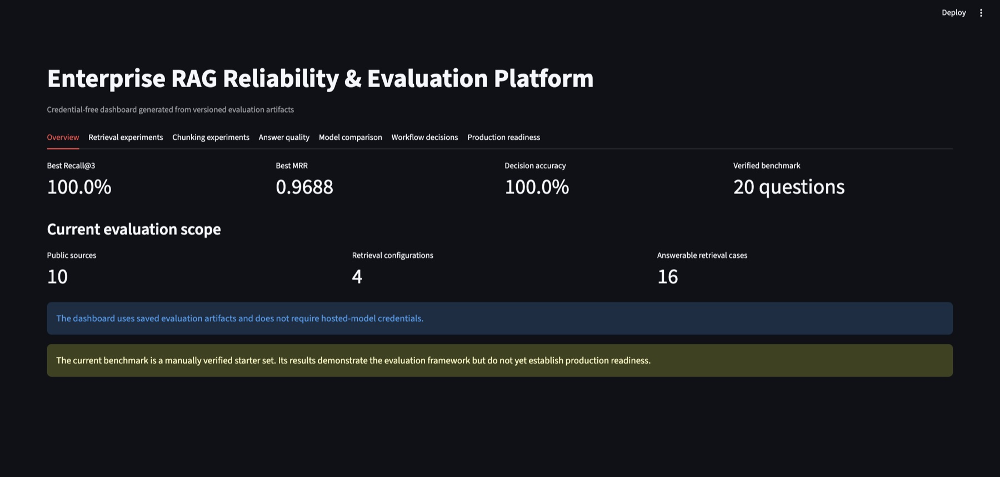
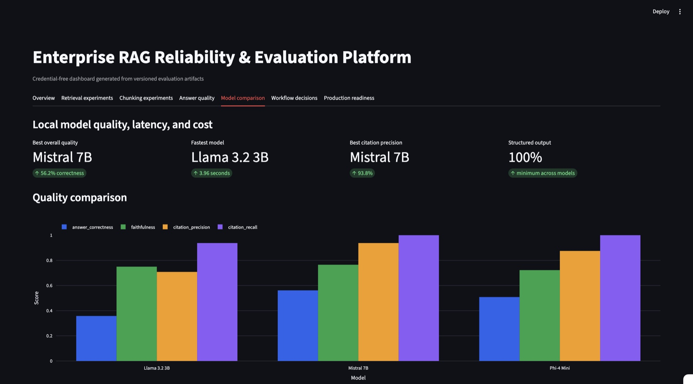

# Enterprise RAG Reliability & Evaluation Platform

[](https://github.com/jangoansahasra/enterprise-rag-evaluation-platform/actions/workflows/evaluation-gates.yml)


A production-oriented platform for measuring whether enterprise RAG and LLM systems are accurate, grounded, safe, cost-effective, and ready for release.

This is not another chatbot. It is an evaluation and reliability system that compares retrieval strategies, detects unsupported answers, validates citations, tests refusal and escalation behavior, tracks experiments, and blocks regressions in CI.

The evaluated application is an enterprise IT support and policy assistant grounded in real public GitLab handbook content. The benchmark is manually verified; no synthetic policies or model-generated ground truth are used.

## Reliability dashboard



The credential-free dashboard presents versioned evaluation results immediately, even when hosted-model endpoints are unavailable.

## Results at a glance

| Capability | Result |
|---|---:|
| Verified benchmark | 20 questions |
| Public knowledge sources | 10 |
| Best retrieval Recall@3 | 100% |
| Best retrieval MRR | 0.9688 |
| Workflow decision accuracy | 100% |
| Deterministic faithfulness | 100% |
| Hallucination rate | 0% |
| Citation precision | 100% |
| Citation recall | 100% |
| Structured-output reliability | 100% across three local models |
| Automated tests | 47 passing |
| CI regression gates | 13 |
| Dashboard Docker image | 878 MB |

These results apply to the current small, manually verified benchmark and do not by themselves establish enterprise production readiness. The system card documents the remaining validation requirements.

## What the platform evaluates

- Fixed, recursive, and heading-aware chunking configurations
- BM25, dense, hybrid, and reranked retrieval
- Retrieval quality and latency tradeoffs
- Evidence selection and multi-document citation coverage
- Answer correctness, faithfulness, and hallucination behavior
- Refusal and human-escalation correctness
- Local-model quality, latency, tokens, and cost
- Prompt and system regressions through CI quality gates
- Production readiness through versioned evaluation artifacts

## Technology

Python, LangGraph, Sentence Transformers, FAISS, BM25, cross-encoder reranking, RAGAS, DeepEval, MLflow, OpenTelemetry, Streamlit, Pytest, Docker, GitHub Actions, and local Ollama models.

## Quick start

```bash
git clone https://github.com/jangoansahasra/enterprise-rag-evaluation-platform.git
cd enterprise-rag-evaluation-platform

python3 -m venv .venv
source .venv/bin/activate

python -m pip install --upgrade pip
python -m pip install -e ".[dev]"

python scripts/validate_data.py
python -m pytest -q
python scripts/check_quality_gates.py
python -m streamlit run dashboard/app.py
```
Open http://localhost:8501 to view the saved-results reliability dashboard. Hosted-model credentials are not required.

## Retrieval evaluation

The platform evaluates retrieval separately from answer generation so retrieval failures remain distinguishable from generation and grounding failures.

The dependency-free BM25 implementation provides the reproducible CI baseline:

```bash
PYTHONPATH=src python -m rag_reliability.cli
```
The complete experiment compares BM25, dense retrieval, hybrid reciprocal-rank fusion, and cross-encoder reranking:
```bash
PYTHONPATH=src python scripts/run_retrieval_experiments.py
```
Cross-encoder reranking achieved the strongest retrieval result with 100% Recall@3 and 0.9688 MRR. Versioned reports include per-question rankings, latency measurements, and failure cases.

See the [retrieval experiment report](docs/retrieval-results.md) for results, tradeoffs, and limitations.

This presents BM25 as an intentional baseline instead of describing the repository as an early “first working slice.”

## Documentation

- [Architecture](docs/architecture.md)
- [System card](docs/system-card.md)
- [Model card](docs/model-card.md)
- [Controlled LangGraph workflow](docs/controlled-workflow.md)
- [Retrieval experiments](docs/retrieval-results.md)
- [Chunking experiments](docs/chunking-experiments.md)
- [Answer-quality evaluation](docs/answer-quality-evaluation.md)
- [Evidence selection](docs/evidence-selection.md)
- [Model comparison](docs/model-comparison.md)
- [Experiment tracking and observability](docs/experiment-tracking.md)
- [CI regression gates](docs/ci-regression-gates.md)
- [Docker deployment](docs/docker-deployment.md)

## Data rules

- Keep the handbook's organization and policy context explicit. Do not present GitLab policy as general advice for other employers.
- Record the source URL and section for every answerable question.
- Use `escalate` when a request requires a human decision or authorization.
- Use `refuse` for requests that ask the assistant to bypass a documented restriction.
- Recheck source pages before a released benchmark version; public handbook content can change.
- Credit GitLab and comply with its [handbook reuse terms](https://handbook.gitlab.com/handbook/about/handbook-usage/).

## Controlled decision workflow

The bounded answer, refusal, and escalation flow is documented in the [controlled workflow report](docs/controlled-workflow.md).

## Experiment tracking and observability

Retrieval experiments create separate MLflow runs for BM25, dense, hybrid, and reranked configurations. Each run records configuration parameters, retrieval metrics, latency, tags, and the complete evaluation report.

Structured JSON logs and OpenTelemetry spans capture request IDs, configuration details, evaluation results, latency, failures, and trace context.

```bash
PYTHONPATH=src python scripts/run_retrieval_experiments.py

python -m mlflow ui \
  --backend-store-uri sqlite:///artifacts/mlflow/mlflow.db \
  --default-artifact-root ./artifacts/mlflow/artifacts \
  --port 5000
```

## Answer-quality evaluation

The platform evaluates answer correctness, evidence faithfulness, hallucination rate, citation precision and recall, refusal correctness, and escalation correctness. The first credential-free baseline achieved 100% decision accuracy and deterministic faithfulness, while identifying two citation weaknesses and an answer-conciseness gap.

```bash
PYTHONPATH=src python scripts/evaluate_answer_quality.py
```
See [answer-quality evaluation](docs/answer-quality-evaluation.md) for metric definitions, results, and limitations.

A regression-driven evidence-selection improvement uses heading-aware lexical coverage with a cross-encoder score guard and bounded multi-document aggregation. It increased citation precision from 93.75% to 100% and citation recall from 90.62% to 100% without reducing decision accuracy or faithfulness. See [evidence-selection improvement](docs/evidence-selection.md).


## RAGAS and DeepEval evaluation

The project exports a shared set of 16 verified, answerable cases to RAGAS and DeepEval without requiring hosted-model credentials.

RAGAS ID-based evaluation achieved 100% context recall and 35.42% raw context precision. The result shows that verified evidence is consistently retrieved while additional candidates remain available for the evidence-selection stage.

DeepEval custom deterministic metrics achieved 100% faithfulness, a 56.59% mean lexical answer-correctness score, and a 75% correctness pass rate. The lexical score is treated as a conservative proxy because valid paraphrases can differ from the verified answer wording.

```bash
PYTHONPATH=src python scripts/export_judge_cases.py \
  --validate-adapters

RAGAS_DO_NOT_TRACK=true \
PYTHONPATH=src \
python scripts/run_ragas_id_evaluation.py

PYTHONPATH=src python scripts/run_deepeval_deterministic.py
```
## Local model comparison

The platform compares Llama 3.2 3B, Mistral 7B, and Phi-4 Mini over the same 16 verified enterprise RAG cases using local Ollama inference.



All three models achieved 100% structured-output reliability under constrained JSON decoding. Mistral 7B produced the strongest overall quality with 56.18% lexical answer correctness, 76.53% deterministic faithfulness, 93.75% citation precision, and 100% citation recall. Llama 3.2 was fastest at 3.96 seconds per case, while Mistral averaged 7.23 seconds.

```bash
caffeinate -i env PYTHONPATH=src \
  python scripts/run_model_comparison.py
```
The experiment records answer quality, evidence support, citation correctness, structured-output reliability, latency, token usage, cost, and failures. Local inference has zero API cost, while compute and operational costs remain outside the current estimate.
See [local model comparison](docs/model-comparison.md) for results, failure analysis, reproducibility notes, and metric limitations.

## Document processing and chunking

The versioned document-processing pipeline validates public-source metadata,
preserves headings and provenance, generates stable content hashes, and tracks experimental chunks back to their original passages.

Seven heading-aware, fixed-size, and recursive configurations were compared
with BM25 while keeping retrieval settings constant. Fixed 80-character chunks with 20-character overlap improved Recall@3 from 81.25% to 87.50% and MRR from 0.6875 to 0.6979, while increasing the index from 19 to 37 chunks.

```bash
PYTHONPATH=src python scripts/run_chunking_experiments.py
```
See [document processing and chunking experiments](docs/chunking-experiments.md)
for configuration details, question-level analysis, version tracking, and
limitations.

## Docker deployment

The repository provides a lightweight saved-results dashboard image and a
separate complete experiment-pipeline target.

```bash
docker compose build
docker compose up -d
```
Open http://localhost:8501 to view the credential-free dashboard

The tested dashboard container passed its Docker health check and HTTP health
endpoint. Separating dashboard and pipeline dependencies reduced the dashboard image from 10.8 GB to 878 MB.

Build the complete reproducible pipeline separately:
```bash
docker build \
  --target pipeline \
  --tag enterprise-rag-pipeline:local \
  .
```
See [Docker deployment](docs/docker-deployment.md) for health checks, security controls, port configuration, pipeline commands, and reproducibility limits.

## Architecture and responsible-AI documentation

The [architecture document](docs/architecture.md) describes the verified data
layer, document processing, retrieval experiments, controlled LangGraph
workflow, model abstraction, evaluation systems, observability, CI gates, and
Docker deployment.

The [system card](docs/system-card.md) documents intended use, excluded use,
data provenance, recorded performance, safety controls, human oversight,
security considerations, limitations, monitoring, and the current
production-readiness decision.

The [model card](docs/model-card.md) documents the local Llama, Mistral, and Phi comparison, structured-output controls, selection guidance, failure analysis, metric limitations, and reproducibility.

[Live CI RAG regression gates](docs/ci-regression-gates.md) enforce retrieval, grounding, citation, refusal, and escalation thresholds on every relevant change.