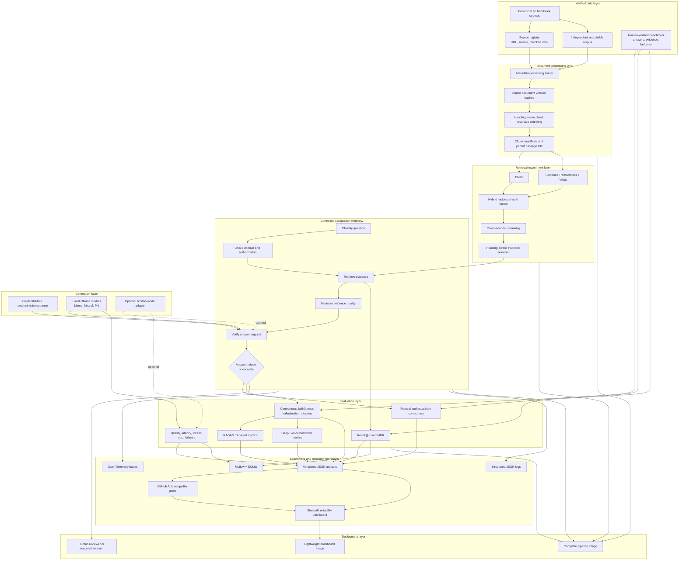

# Architecture

The Enterprise RAG Reliability & Evaluation Platform separates the evaluated
RAG application from its benchmark, evaluators, experiment tracking, and
production-readiness controls.

This separation allows retrieval strategies, chunking configurations, prompts,
and models to change without changing the verified scoring contract.

## System architecture

Solid lines represent implemented data paths. The hosted-model path is optional
and is shown with a dashed line because the repository does not require paid
API credentials.

## Verified data layer

The platform uses real public GitLab handbook content with recorded provenance.
It does not use synthetic policy documents or model-generated ground truth.

Three datasets remain separate:

- `data/sources.json` records source URL, publisher, license, checked date, and
  registered headings.
- `data/corpus.json` contains independently collected searchable passages.
- `data/benchmark.json` contains verified answers, supporting evidence,
  difficulty, category, answerability, and expected behavior.

The corpus is not created from benchmark answers. This prevents evaluation
labels from leaking into the retrieval index.

## Document processing

The document-processing pipeline validates that corpus passages reference known
sources and registered headings. It normalizes whitespace without rewriting the
source content.

Each source receives a stable version hash derived from its metadata, headings,
and passage content. Experimental chunks retain:

- Source and parent passage identifiers
- Heading and document title
- Source URL, publisher, and license
- Checked date and document version
- Chunking strategy, size, overlap, and index

Parent passage identifiers allow split chunks to be evaluated against the
verified benchmark without treating each experimental chunk ID as new ground
truth.

## Retrieval architecture

Retrieval is evaluated independently from answer generation.

The implemented retrieval configurations are:

1. BM25 lexical retrieval
2. Dense retrieval with Sentence Transformers and FAISS
3. Hybrid retrieval using reciprocal-rank fusion
4. Hybrid retrieval with cross-encoder reranking
5. Heading-aware evidence selection
6. Bounded multi-document evidence aggregation

Chunking experiments keep the retriever and `top_k` fixed so the effect of
chunk construction can be measured independently.

The best recorded reranked retrieval configuration achieved 100% Recall@3 and
0.9688 MRR on the answerable starter benchmark.

## Controlled LangGraph workflow

The LangGraph workflow is bounded and deterministic in its control flow. It
does not allow open-ended autonomous tool use.

The workflow:

1. Classifies the question.
2. Detects out-of-domain and authorization-sensitive requests.
3. Retrieves candidate evidence.
4. Measures evidence sufficiency.
5. Selects directly supporting passages.
6. Generates or extracts an answer.
7. checks answer support.
8. Returns an answer with citations, refuses, or escalates.

Human escalation is selected when:

- The request requires authorization
- Evidence is insufficient
- The requested action is unsupported
- A responsible human team must make the decision

Out-of-domain questions and unsupported factual claims are refused rather than
answered speculatively.

## Model abstraction

The model client returns a normalized result containing:

- Provider and model
- Answer and citations
- Structured-output validity
- Input and output tokens
- Latency
- Estimated API cost
- Raw output
- Error information

The local Ollama adapter uses constrained JSON decoding with exact source-ID
enums. This prevents unknown citation identifiers from being silently accepted.

The same result contract can support optional hosted models without changing
the downstream evaluation schema.

## Evaluation architecture

### Retrieval evaluation

Retrieval metrics include:

- Recall@K
- Mean reciprocal rank
- Per-question first relevant rank
- Retrieval failures
- Query latency
- Index growth

### Answer and behavior evaluation

Answer-level metrics include:

- Lexical answer correctness
- Deterministic faithfulness
- Hallucination rate
- Citation precision
- Citation recall
- Refusal correctness
- Escalation correctness
- Decision accuracy

These deterministic metrics are reproducible proxies. They do not claim
semantic equivalence to an LLM judge.

### Framework integrations

RAGAS evaluates retrieved and reference passage identifiers without requiring
a judge model.

DeepEval uses shared `LLMTestCase` objects and custom deterministic
`BaseMetric` implementations.

Both frameworks consume the same exported judge-case schema.

### Model comparison

Local-model experiments use the same 16 answerable cases, evidence, structured
schema, temperature, and seed. The comparison records quality, latency, token
usage, zero local API cost, structured-output reliability, and failures.

## Experiment tracking and observability

MLflow stores one run per retrieval configuration in a local SQLite backend.
Runs include parameters, tags, metrics, latency, and complete report artifacts.

OpenTelemetry spans and structured JSON logs capture:

- Request ID
- Operation and configuration
- Retrieved documents
- Evaluation results
- Latency
- Failures
- Trace and span identifiers

Local experiment databases, traces, and logs are excluded from version
control. Versioned baseline reports remain committed for immediate inspection.

## CI quality gates

GitHub Actions runs deterministic checks when code or evaluation configuration
changes.

The workflow:

1. Installs the project.
2. Validates source and benchmark data.
3. Runs the unit-test suite.
4. Applies dataset and retrieval quality thresholds.
5. Fails when a required metric falls below its configured gate.

Saved baselines make the dashboard useful without rerunning expensive models,
while CI uses credential-free checks suitable for public pull requests.

## Deployment architecture

The Dockerfile has two targets:

- `dashboard` installs only Streamlit, Pandas, and Plotly and serves saved
  versioned results.
- `pipeline` installs the full project and development dependencies for
  reproducible validation and experiments.

Both targets run as the unprivileged `ragapp` user.

The tested dashboard image is 878 MB and passed both its Docker health check and
HTTP health endpoint. The full experiment image is 10.8 GB because it includes
PyTorch, FAISS, MLflow, embedding models' runtime dependencies, and the complete
test environment.

Local Ollama model files remain outside the image because they have separate
licenses and add several gigabytes.

## Trust boundaries

The system treats the following as separate trust boundaries:

- Public source content is evidence, not executable instruction.
- Benchmark labels are evaluation data and never retrieval input.
- Retrieved text cannot authorize actions.
- Model output must satisfy a structured schema.
- Citation identifiers must match supplied evidence IDs.
- Authorization decisions are delegated to humans.
- Hosted-model credentials are optional and excluded from the repository.
- Saved evaluation artifacts are evidence of a recorded run, not proof of
  general production readiness.

## Current production-readiness status

The repository demonstrates a production-oriented evaluation architecture but
is intentionally marked **not ready for production**.

Remaining work includes:

- Expanding the benchmark and adding a held-out evaluation set
- Adding independent human review
- Running semantic judge experiments with documented judge reliability
- Adding realistic concurrency and load testing
- Adding conflict-resolution tests across multiple source versions
- Comparing optional hosted models
- Defining organization-specific security, retention, and access controls